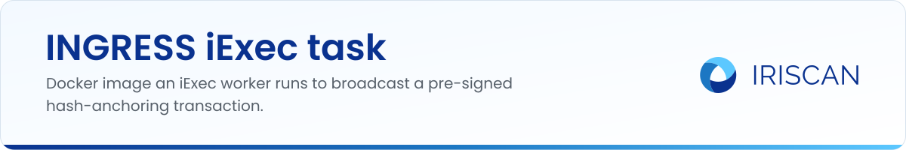
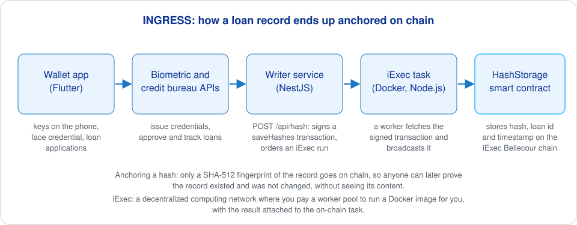

# INGRESS iExec task

The Docker image that an [iExec](https://iex.ec) worker runs to put INGRESS loan-record hashes on the blockchain. INGRESS is an Iriscan project from the EU NGI ONTOCHAIN program: biometric credentials and verifiable credit histories for microlending. The [writer service](https://github.com/biometric-technologies/ontochain-iexec-writer) prepares and signs a transaction for the `HashStorage` contract; this task is the piece that fetches the signed bytes and broadcasts them, so the writer's keys are never inside the worker. It is about fifty lines of Node.js.



Anchoring a hash means writing only a fingerprint of a record (here SHA-512) to the chain: anyone can later check that a record existed at a given time and was not altered, while the record itself stays private. iExec is a decentralized computing network: you pay a worker pool to run a Docker image for you, and the result is tied to an on-chain task.

## What it does

- Takes two arguments from the iExec request: the JSON-RPC URL of the chain and a one-time URL on the writer service.
- Downloads the already signed transaction from that URL (the writer deletes the file after the first read).
- Broadcasts it with `ethers` through the RPC endpoint and waits for the receipt.
- Writes the receipt to `$IEXEC_OUT/callback.txt` and declares it as the deterministic output in `computed.json`, which is how an iExec task reports its result.
- On any error writes `$IEXEC_OUT/error.txt`, points `computed.json` at it and exits with code 1.

## How to run

Build the image (Node 18 on Alpine):

```sh
docker build -t info-saver .
```

Run it locally the way a worker would, with an output folder and the two arguments:

```sh
mkdir -p iexec_out
docker run --rm -e IEXEC_OUT=/app/iexec_out -v $PWD/iexec_out:/app/iexec_out \
  info-saver https://bellecour.iex.ec https://writer.example.org/api/file/<id>
cat iexec_out/callback.txt
```

To make it available on the iExec network, push the image to a registry and deploy it as an iExec app with the `iexec` SDK or CLI; the writer's `app.service.ts` contains the `deployApp` call that was used, and the resulting app address goes into the writer's `IEXEC_APP_ADDRESS`. `npm start` runs `src/app.js` directly if you prefer to test without Docker.

## Related repositories

- [ontochain-iexec-writer](https://github.com/biometric-technologies/ontochain-iexec-writer): the NestJS service that signs the transaction and orders the task.
- [ontochain-iexec-smartcontract](https://github.com/biometric-technologies/ontochain-iexec-smartcontract): the `HashStorage` Solidity contract the transaction calls.
- [ontochain-digital-wallet](https://github.com/biometric-technologies/ontochain-digital-wallet): the Flutter wallet users apply for loans with.
- [ingress-site](https://github.com/biometric-technologies/ingress-site): project website with user guides.

## License

License: not yet specified.

## Contact

info@iriscan.net, https://www.iriscan.com
